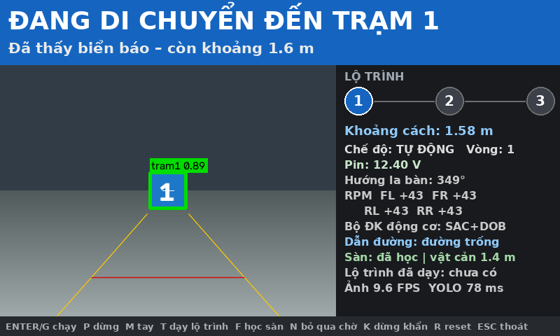
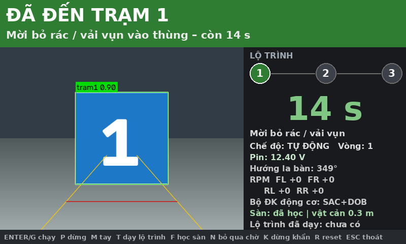
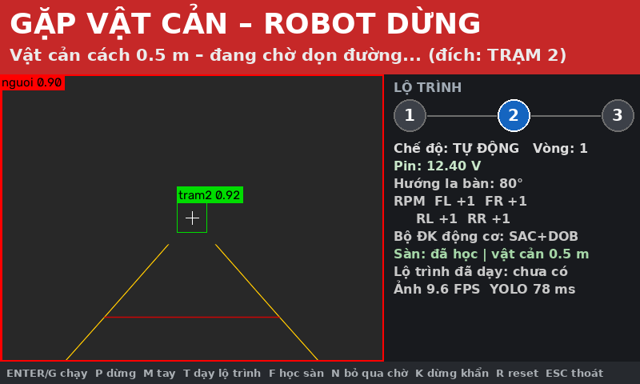
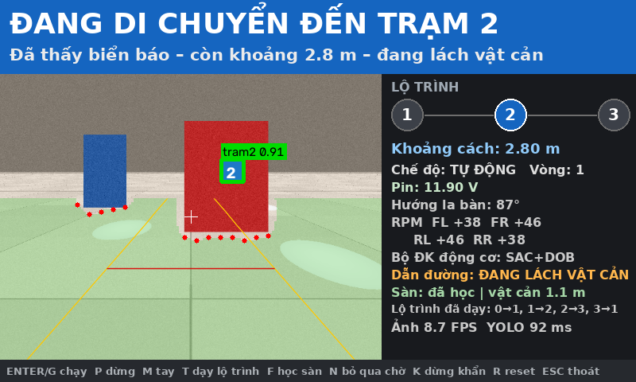
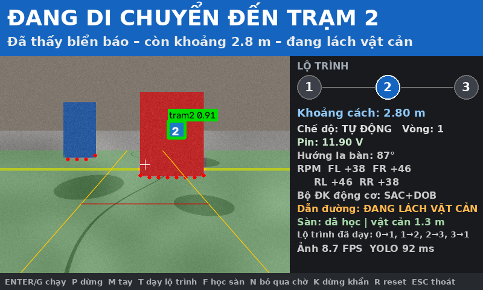
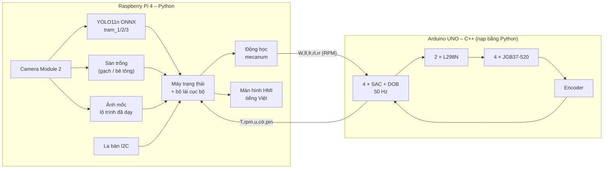

# ROBOT THU GOM RÁC / VẢI VỤN XƯỞNG MAY

Robot 4 bánh mecanum tự đi đến **TRẠM 1 → TRẠM 2 → TRẠM 3**, dừng **15 giây** (theo kế hoạch ngày 1; sửa `wait_s` nếu muốn 20 s) cho công nhân bỏ rác / vải vụn,
**không dán line**: chỉ dùng **camera** để nhận diện trạm (YOLO), nhận diện mặt sàn trống (gạch đá hoa / bê tông),
đi theo lộ trình đã dạy, **dừng khi gặp vật cản** và hiển thị trạng thái lên màn hình.
Động cơ được điều khiển bằng thuật toán **SAC + DOB (thích nghi)** trên Arduino UNO.

> **Mới làm xử lý ảnh / máy tính nhúng?** Đọc trước `docs/BAT_DAU_CHO_NGUOI_MOI.md`
> (file nào chạy ở Arduino, file nào chạy ở Raspberry Pi, 4 bài tập chạy được ngay trong `examples/`).

| Đang di chuyển | Đã đến trạm (đếm ngược) | Gặp vật cản |
|---|---|---|
|  |  |  |

| Nhận diện sàn trống – gạch đá hoa | Nhận diện sàn trống – bê tông |
|---|---|
|  |  |

---

## 1. Thông tin hệ thống (giả thiết thiết kế – sửa trong `robot/config.py` nếu khác)

| Hạng mục | Lựa chọn trong đề tài |
|---|---|
| Máy tính xử lý ảnh | Raspberry Pi 4 Model B (≥ 2 GB RAM), **Raspberry Pi OS Bookworm 64-bit**, Python 3.11 |
| Camera | Raspberry Pi **Camera Module 2** (IMX219, CSI) qua `picamera2`; webcam USB cũng chạy được |
| Bộ điều khiển động cơ | **Arduino UNO R3** (ATmega328P 16 MHz) – firmware C++ do **Python sinh cấu hình, biên dịch và nạp** (`arduino-cli` 1.x, core `arduino:avr`) |
| Driver | 2 × **L298N** (tháo jumper ENA/ENB để băm xung PWM) |
| Động cơ | 4 × **JGB37-520 12 V 110 RPM có encoder Hall** (11 xung/vòng, hộp số ~1:90) – dùng kênh A |
| Bánh | 4 × **mecanum 97 mm** (bố trí chữ X) |
| Nguồn | Pin **LiPo 3S** (11.1 V) + mạch hạ áp **5 V ≥ 3 A** riêng cho Pi (cần bổ sung) |
| La bàn | GY-271 **QMC5883L** (hoặc HMC5883L) trên **I2C của Pi** – gợi ý hướng & giữ hướng |
| HMI | Màn hình HDMI/DSI 5"–7" 800×480 gắn Pi (giao diện tiếng Việt có dấu) + LCD 16×2 I2C (tùy chọn) |
| Thị giác | **YOLO11n** (Ultralytics) – 1 mô hình chung, lớp `0=tram_1, 1=tram_2, 2=tram_3`, ảnh 416, chạy **`best.onnx` bằng onnxruntime** (không cần torch trên Pi) |
| Truyền thông | Pi ↔ Arduino: **USB-Serial 115200 8N1, giao thức ASCII** (xem đầu `robot_firmware.ino`) |
| Chế độ | **Tự động** (lộ trình trạm), **Tay** (bàn phím), **Dạy lộ trình**, **Dừng khẩn** (phần cứng + phần mềm) |

> **Vì sao firmware Arduino là C++ mà không phải Python?** Arduino UNO chỉ có 2 KB RAM / 32 KB Flash – không chạy được
> MicroPython/CircuitPython (cần ≥ 16 KB RAM, 256 KB Flash). Phương án Firmata (Python trên Pi điều khiển từng chân)
> cũng không đáp ứng được: 4 encoder tạo ~15 000 ngắt/giây và vòng điều khiển 50 Hz cần thời gian thực.
> Giải pháp của đề tài: **mọi thứ thao tác bằng Python** – bạn chỉ sửa `robot/config.py`, chạy `python flash_arduino.py`
> là Python tự sinh `config_gen.h`, biên dịch, nạp và kiểm tra firmware; tham số SAC-DOB chỉnh trực tiếp từ Python
> khi đang chạy (`tools/motor_test.py tune`); thuật toán có **bản Python giống hệt** (`robot/sac_dob.py`) được
> kiểm tra tự động khớp với bản C++.

## 2. Kiến trúc



## 3. Cấu trúc thư mục

```
robot_xuong_may/
├── main.py                  # CHƯƠNG TRÌNH CHÍNH (Pi)
├── flash_arduino.py         # sinh cấu hình + biên dịch + nạp Arduino bằng Python
├── robot/
│   ├── config.py            # ★ TOÀN BỘ THÔNG SỐ (chân, cơ khí, SAC-DOB, trạm, sàn, lộ trình...)
│   ├── mission.py           # máy trạng thái nhiệm vụ
│   ├── floor.py             # nhận diện mặt sàn trống (gạch đá hoa / bê tông)
│   ├── navigator.py         # bộ lái cục bộ (lách / dừng) + nhớ vật cản
│   ├── route_memory.py      # dạy – lặp lộ trình bằng ảnh mốc ORB
│   ├── geometry.py          # hình học camera (pixel ↔ mét trên sàn)
│   ├── detector.py          # YOLO
│   ├── camera.py  compass.py  odometry.py  kinematics.py  serial_link.py
│   ├── display.py           # HMI 800×480 tiếng Việt + LCD 16x2
│   ├── sac_dob.py           # bản Python của SAC-DOB (mô phỏng / đối chiếu)
│   ├── fwconfig.py          # sinh config_gen.h + mã băm cấu hình
│   ├── gpio_io.py           # nút START/STOP, còi
│   └── simworld.py          # mô phỏng toàn bộ (chạy thử không cần phần cứng)
├── firmware/robot_firmware/ # robot_firmware.ino, sac_dob.h, config_gen.h (tự sinh)
├── training/                # kiểm tra dataset (check_dataset), xuất ONNX + metadata, đánh giá; công cụ cho nhóm train
├── tools/                   # motor_test.py, sac_dob_sim.py, compass_calibrate.py
├── examples/                # 4 bài tập cho người mới: camera, nhận diện, gửi lệnh Arduino, máy trạng thái
├── tests/                   # 128 kiểm thử tự động (pytest), gồm chạy firmware trên ATmega328P mô phỏng
├── docs/                    # WIRING.md, NAVIGATION.md, SAC_DOB.md, TRAINING.md, ảnh
└── scripts/                 # install_pi.sh, robot-autostart.desktop
```

## 4. Cài đặt (trên Raspberry Pi 4)

```bash
git clone <repo> && cd trungthu/robot_xuong_may
bash scripts/install_pi.sh          # apt + venv + pip + arduino-cli + kiểm thử
source .venv/bin/activate
```
Bật camera/I2C nếu cần: `sudo raspi-config` → Interface Options. Kiểm tra: `rpicam-hello -t 3000`, `i2cdetect -y 1`.

Chạy thử **không cần phần cứng** (laptop/Pi): `python main.py --sim` – phím **O** đặt/xóa người chắn đường.

## 5. Quy trình chạy thử từng bước (commissioning)

| Bước | Lệnh | Đạt khi |
|---|---|---|
| 1. Đấu dây | theo `docs/WIRING.md` | GND chung, tháo jumper ENA/ENB, nguồn Pi riêng |
| 2. Nạp Arduino | `python flash_arduino.py` (lần đầu thêm `--install-cli`) | "KHỚP cấu hình – nạp thành công!" |
| 3. Chiều quay + encoder | kê robot lên, `python tools/motor_test.py dir` | 4 bánh quay tiến, đo được RPM dương |
| 4. Tỉ số truyền | `python tools/motor_test.py count --turns 10` | sai lệch < 3 % (nếu không, sửa `GEAR_RATIO`) |
| 5. Lắp mecanum | `python tools/motor_test.py pattern` | đi ngang không xoay |
| 6. Nhận dạng động cơ | `python tools/motor_test.py ident` | ghi `PWM_DEADZONE`, `DOB_KN`, `DOB_TAU_N` vào config, nạp lại |
| 7. Đáp ứng SAC-DOB | `python tools/motor_test.py step --modes 0 1 2` | đồ thị `logs/step_*.png` – dùng cho báo cáo |
| 8. La bàn | `python tools/compass_calibrate.py` | lưu `compass_cal.json` |
| 9. YOLO | huấn luyện theo `docs/TRAINING.md`, thử `python training/test_model.py` | nhận đúng trạm, ước lượng khoảng cách đúng ±10 % |
| 10. Sàn | `python main.py`, chế độ tay (M), lái quanh xưởng | không báo vật cản giả; đặt thùng thì thấy chấm đỏ đúng chỗ |
| 11. Dạy lộ trình (nếu trạm khuất) | M → T → lái tới trạm → T (mỗi chặng) | "Lộ trình đã dạy: 0→1, 1→2, 2→3, 3→1" |
| 12. Chạy tự động | Enter/G hoặc nút START | đi đủ 3 trạm, chờ 15 s mỗi trạm, dừng khi có vật chắn |

## 6. Vận hành

### Chế độ & phím (cửa sổ giao diện) / nút

| Phím | Chức năng |
|---|---|
| **Enter / G** (nút START GPIO17) | Chạy tự động / chạy tiếp; reset sau lỗi khi dùng nút |
| **P** (nút STOP GPIO27) | Dừng, về SẴN SÀNG (giữ trạm đích) |
| **M** | Bật/tắt chế độ tay: **W/S** tiến-lùi, **A/D** đi ngang, **Q/E** quay, **SPACE** dừng (nhả phím 0.6 s tự dừng) |
| **T** / **U** | Dạy lộ trình: bắt đầu / lưu – hủy |
| **F** | Học lại màu sàn (phía trước robot phải trống) |
| **N** | Bỏ qua thời gian chờ còn lại tại trạm |
| **K** | Dừng khẩn phần mềm (chốt) · **R** reset sau dừng khẩn / lỗi |
| **C** | Đổi bộ điều khiển động cơ PI → SAC → SAC+DOB (so sánh khi bảo vệ đề tài) |
| **ESC** | Thoát chương trình (động cơ dừng) |

### Nội dung màn hình theo trạng thái

| Trạng thái | Dòng chính (màu băng) | Dòng phụ | LCD 16×2 |
|---|---|---|---|
| SẴN SÀNG | SẴN SÀNG (xám) | Trạm kế tiếp: TRẠM n – nhấn START | `SAN SANG` |
| Tìm trạm | **ĐANG DI CHUYỂN ĐẾN TRẠM n** (xanh dương) | Đang quay tìm biển báo trạm... | `DI CHUYEN->TRAMn` |
| Theo lộ trình | **ĐANG DI CHUYỂN ĐẾN TRẠM n** (xanh dương) | Theo lộ trình đã dạy – mốc 12/40 | `DI CHUYEN->TRAMn` |
| Tiếp cận | **ĐANG DI CHUYỂN ĐẾN TRẠM n** (xanh dương) | Đã thấy biển báo – còn khoảng 1.2 m (– đang lách vật cản) | `Cach 1.2 m` |
| Tại trạm | **ĐÃ ĐẾN TRẠM n** (xanh lá) + số đếm ngược lớn | Mời bỏ rác / vải vụn vào thùng – còn 15 s | `DA DEN TRAM n` / `Bo rac: con 15s` |
| Vật cản | **GẶP VẬT CẢN – ROBOT DỪNG** (đỏ nhấp nháy) | Vật cản cách 0.6 m – đang chờ dọn đường | `GAP VAT CAN!` |
| Không thấy trạm | KHÔNG TÌM THẤY TRẠM n (cam) | Kiểm tra biển báo – tự tìm lại sau 10 s | `KHONG THAY TRAM` |
| Dừng khẩn | **DỪNG KHẨN CẤP** (đỏ) | Nhả nút dừng khẩn... nhấn R để reset | `DUNG KHAN CAP` |
| Lỗi | LỖI HỆ THỐNG – ROBOT DỪNG (đỏ) | Mất kết nối Arduino / Lỗi camera / Pin yếu | `LOI HE THONG` |
| Tay / Dạy | ĐIỀU KHIỂN TAY / ĐANG DẠY LỘ TRÌNH: TRẠM a → TRẠM b (tím) | hướng dẫn phím | `DIEU KHIEN TAY` |

## 7. Trình tự công nghệ (chế độ tự động)

| Bước | Trạng thái | Điều kiện vào | Hành động | Điều kiện ra |
|---|---|---|---|---|
| 1 | FOLLOW | START / rời trạm, **có** lộ trình đã dạy cho chặng | bám ảnh mốc, lách vật cản | thấy biển trạm < 2.5 m (3 khung) → 3; hết mốc / mất dấu → 2 |
| 2 | SEARCH | START / rời trạm, **không** có lộ trình | (xoay về hướng la bàn gợi ý) quay tìm biển trạm | thấy biển 3 khung → 3; quá 30 s → LOST |
| 3 | APPROACH | thấy biển trạm đích | căn giữa + tiến, giảm tốc từ 1.2 m, lách vật cản | ≤ 0.45 m & lệch tâm ≤ 0.25 (3 khung) → 4; mất dấu 1.5 s → 2 |
| 4 | WAIT | đã đến trạm | dừng, còi 2 tiếng, đếm ngược 15 s | hết giờ / phím N → trạm kế tiếp (1 hoặc 2) |
| – | OBSTACLE | vật cản trong làn < 0.8 m (≥ 2 khung) hoặc không còn khe đi | dừng, còi dài | đường trống liên tục 1.5 s → về bước trước |

## 8. An toàn & liên động

| Liên động | Thực hiện ở | Tác động |
|---|---|---|
| Nút dừng khẩn nấm NC cắt nguồn động cơ | **phần cứng** | mất nguồn L298N ngay lập tức |
| Tiếp điểm NC dừng khẩn → A4 (tùy chọn) | Arduino | phanh 4 động cơ, chốt, chỉ xóa bằng lệnh `E,0` khi nút đã nhả |
| Mất lệnh từ Pi > 500 ms | Arduino | tốc độ đặt = 0 |
| Watchdog AVR 1 s | Arduino | treo chương trình → tự reset, động cơ tắt khi khởi động |
| Mất telemetry Arduino > 1 s / mất ảnh > 2 s | Pi | LỖI HỆ THỐNG, dừng; khắc phục xong phải nhấn START |
| Pin < 10.2 V liên tục 3 s (khi `BATTERY_SENSE_ENABLE = True`) | Pi | LỖI (Pin yếu), dừng; < 10.8 V cảnh báo |
| Vật cản (YOLO hoặc sàn) trong làn < 0.8 m | Pi | GẶP VẬT CẢN – dừng |
| Chế độ tay có vật cản phía trước | Pi | chặn lệnh tiến (vẫn cho lùi / quay) |
| Giới hạn gia tốc 300 RPM/s, giới hạn 85 RPM | Arduino / Pi | chống trượt bánh, chống lật |

## 9. Báo lỗi & xử lý sự cố

| Hiện tượng / thông báo | Nguyên nhân thường gặp | Cách xử lý |
|---|---|---|
| "Mất kết nối Arduino" | cáp USB, Arduino reset, sai cổng | kiểm tra cáp; `ls /dev/ttyACM* /dev/ttyUSB*`; đặt `SERIAL_PORT` |
| "Firmware Arduino khác config.py" | sửa config chưa nạp lại | `python flash_arduino.py` |
| "Lỗi camera" | cáp dẹt lỏng, chưa bật camera | `rpicam-hello`; cắm lại cáp đúng chiều |
| "Chưa có mô hình YOLO" | thiếu `models/best.onnx` / `best.metadata.json` | `python training/export_model.py --weights best.pt` |
| "Mô hình KHÔNG có lớp…" / "Thứ tự lớp sai" | nhóm train dùng tên / thứ tự lớp khác | train lại đúng `0=tram_1, 1=tram_2, 2=tram_3` (robot không cho chạy tự động) |
| Robot đứng yên dù có lệnh | dừng khẩn chốt; pin yếu; jumper EN chưa tháo | xem flags; nhấn R; kiểm tra pin & dây EN |
| Bánh quay ngược | đấu ngược động cơ | `MOTOR_INVERT` (dùng `motor_test.py dir`) |
| Đi ngang bị xoay | lắp sai chiều con lăn mecanum | lắp lại thành chữ X (`docs/WIRING.md` §5) |
| Tốc độ đo = 0 | encoder chưa cấp 5 V / sai chân | kiểm tra VCC, GND, C1 → D2/D3/A2/A3 |
| Động cơ rung, kêu | DOB quá nhạy, nhiễu encoder | tăng `DOB_TAU_Q`, giảm `SAC_GAMMA_P` (`docs/SAC_DOB.md` §6) |
| Hay báo "GẶP VẬT CẢN" khi đường trống | màu sàn chưa học đúng / sai loại sàn | nhấn **F** khi đường trống; đặt `FLOOR_TYPE`; `docs/NAVIGATION.md` §2 |
| Dừng sai chỗ (xa/gần trạm) | sai `marker_h_m` hoặc `ARRIVE_DISTANCE_M` | đo lại chiều cao biển báo |
| "Mất dấu lộ trình" | cảnh vật đã thay đổi, bị che | dạy lại chặng đó (M → T) |
| "KHÔNG TÌM THẤY TRẠM" | biển bị che / thiếu sáng / khuất | thêm ảnh huấn luyện; dạy lộ trình; kiểm tra ánh sáng |
| Pi chậm / "tia sét" thiếu áp | nguồn 5 V yếu, CPU quá nhiệt | nguồn ≥ 3 A, tản nhiệt + quạt |

## 10. Thông số quan trọng (`robot/config.py`)

| Nhóm | Thông số | Mặc định |
|---|---|---|
| Cơ khí | `HALF_WHEELBASE_M`, `HALF_TRACK_M`, `ROBOT_HALF_WIDTH_M` | 0.10, 0.115, 0.17 (ĐO LẠI) |
| Camera | `CAMERA_HEIGHT_M`, `CAMERA_TILT_DEG` | 0.25 m, 0° (ĐO LẠI) |
| Trạm | `STATIONS[n]["wait_s"]`, `marker_h_m`, `ROUTE`, `ROUTE_LOOP` | 15 s, 0.20 m, (1,2,3), True |
| Tiếp cận | `ARRIVE_DISTANCE_M`, `V_APPROACH_MAX` | 0.45 m, 0.22 m/s |
| Vật cản | `OBST_STOP_DISTANCE_M`, `OBST_CLEAR_S`, `NAV_AVOID_ENABLE` | 0.8 m, 1.5 s, True |
| Sàn | `FLOOR_TYPE`, `FLOOR_LIKE_RATIO`, `FLOOR_MIN_OBST_HEIGHT_M` | "auto", 0.12, 0.08 m |
| Lộ trình | `ROUTE_ENABLE`, `ROUTE_V`, `ROUTE_HANDOFF_DISTANCE_M` | True, 0.18 m/s, 2.5 m |
| Động cơ | `CONTROLLER_MODE`, `SAC_*`, `DOB_*`, `PWM_DEADZONE` | 2 (SAC+DOB) |

## 11. Kiểm thử phần mềm

```bash
python -m pytest -q        # 128 kiểm thử: máy trạng thái, mô phỏng đủ lộ trình, tránh vật cản, dạy-lặp,
                           # bộ nhận diện ONNX, Arduino giả qua cổng ảo, chia dữ liệu theo buổi,
                           # nhận diện sàn (gạch/gạch bông/bê tông), ORB, động học, giao thức,
                           # SAC-DOB và ĐỐI CHIẾU bản C++ firmware với bản Python
python tools/sac_dob_sim.py   # đồ thị so sánh PI / SAC / SAC+DOB -> docs/img/sac_dob_sim.png
```
Firmware đã biên dịch với **Arduino AVR core 1.8.6** (board UNO, 0 cảnh báo): 16 202 byte (49 %), RAM 797 byte (39 %),
và đã **chạy trên chip ATmega328P mô phỏng** (simavr) với mô hình 4 động cơ / encoder: bám tốc độ, tự dừng khi mất lệnh,
dừng khẩn, xử lý lệnh sai (`tests/test_firmware_sim.py`). **Chưa chạy trên board và động cơ thật** – làm bước 3–12 ở mục 5.

## 12. Giới hạn cần nêu trong báo cáo

* Camera đơn chỉ thấy phía trước (±31°): robot **không lùi mù** (`DEPART_REVERSE_S = 0`), không thấy vật phía sau/bên hông
  (bộ nhớ vật cản 10 s bù một phần khi lách).
* YOLO chỉ nhận ra loại vật **đã huấn luyện**; nhận diện sàn bổ sung vật lạ nhưng **không** tách được vật cùng màu sàn.
* Sàn bóng như gương, ánh sáng nhấp nháy mạnh, bụi bám ống kính làm giảm độ tin cậy → lau camera, kính phân cực.
* Dạy–lặp lộ trình phụ thuộc cảnh vật: dời máy/kệ nhiều phải dạy lại.
* La bàn trong xưởng có khung thép bị nhiễu → chỉ dùng gợi ý hướng, không dùng để định vị.
* Kết quả SAC-DOB trong tài liệu là **mô phỏng**; số liệu thật lấy bằng `tools/motor_test.py step`.

## 13. Tài liệu chi tiết

* **`docs/BAT_DAU_CHO_NGUOI_MOI.md` – người mới đọc trước: file nào chạy ở Arduino, file nào ở máy tính nhúng, 4 bài tập**

* **`docs/NAP_ARDUINO.md` – sơ đồ chân Arduino, sơ đồ nguồn, các bước nạp (kèm `docs/BANG_DAU_DAY_ARDUINO.xlsx` để in, tích từng dây)**
* `docs/WIRING.md` – sơ đồ đấu dây, bảng chân, nguồn, an toàn điện
* `docs/NAVIGATION.md` – dẫn đường bằng camera, nhận diện sàn, lách vật cản, dạy – lặp lộ trình
* `docs/SAC_DOB.md` – lý thuyết, cài đặt, mô phỏng, quy trình chỉnh SAC + DOB
* `docs/TRAINING.md` – khối số trạm, chụp, gán nhãn, chia theo buổi, huấn luyện, xuất ONNX, đánh giá
* `docs/HUONG_DAN_NGAY_1.md` – **hướng dẫn từng giờ cho người viết code theo kế hoạch train 3 trạm ngày 1**
* `docs/YEU_CAU_NHOM_TRAIN.md` – yêu cầu bàn giao gửi 3 người train (tên lớp, định dạng nhãn, chia theo buổi, hạn)

**Tham khảo:** Kaufman, Barkana, Sobel – *Direct Adaptive Control Algorithms* (Springer); Ohnishi et al. – *Motion control for
advanced mechatronics* (DOB, IEEE/ASME T-Mech 1996); Ulrich & Nourbakhsh – *Appearance-Based Obstacle Detection with
Monocular Color Vision* (AAAI 2000); Chen & Birchfield – *Qualitative Vision-Based Mobile Robot Navigation* (ICRA 2006);
Borenstein & Koren – *The Vector Field Histogram* (1991); Ultralytics YOLO docs (export ONNX).
