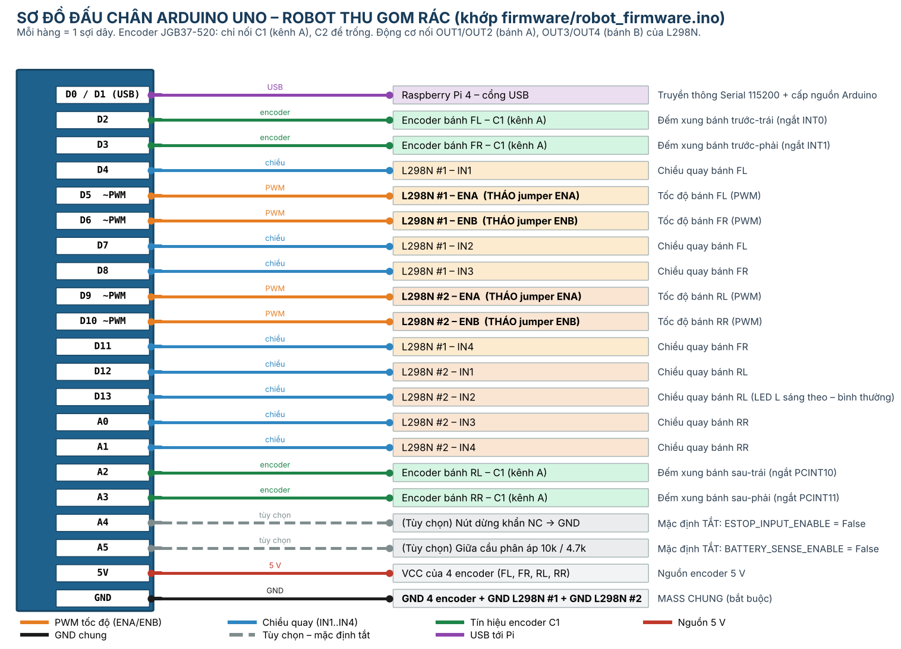
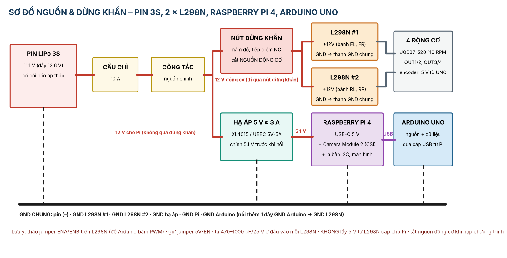

# ĐẤU DÂY & NẠP ARDUINO (làm lúc 10:00)

> In bảng đấu dây để tích từng dây: **`docs/BANG_DAU_DAY_ARDUINO.xlsx`**
> (sheet *Dau day Arduino* · *Nguon - an toan* · *Truoc khi nap*). Chi tiết điện: `docs/WIRING.md`.

**Lưu ý:** firmware Arduino **không phụ thuộc** mô hình YOLO nên nạp lúc nào cũng được, kể cả khi nhóm chưa train xong.
Mô hình (`models/best.onnx`) chỉ chép vào Raspberry Pi, không nạp xuống Arduino.

## 1. Sơ đồ chân Arduino UNO

| Chân UNO | Nối tới | Chức năng |
|---|---|---|
| D0 / D1 | cổng USB → Raspberry Pi | Serial 115200 + nguồn Arduino |
| **D2** | Encoder **FL** – C1 | xung bánh trước-trái (INT0) |
| **D3** | Encoder **FR** – C1 | xung bánh trước-phải (INT1) |
| **D4** | L298N #1 – IN1 | chiều bánh FL |
| **D5** ~ | L298N #1 – **ENA** (tháo jumper) | PWM bánh FL |
| **D6** ~ | L298N #1 – **ENB** (tháo jumper) | PWM bánh FR |
| **D7** | L298N #1 – IN2 | chiều bánh FL |
| **D8** | L298N #1 – IN3 | chiều bánh FR |
| **D9** ~ | L298N #2 – **ENA** (tháo jumper) | PWM bánh RL |
| **D10** ~ | L298N #2 – **ENB** (tháo jumper) | PWM bánh RR |
| **D11** | L298N #1 – IN4 | chiều bánh FR |
| **D12** | L298N #2 – IN1 | chiều bánh RL |
| **D13** | L298N #2 – IN2 | chiều bánh RL (LED "L" sáng theo – bình thường) |
| **A0** | L298N #2 – IN3 | chiều bánh RR |
| **A1** | L298N #2 – IN4 | chiều bánh RR |
| **A2** | Encoder **RL** – C1 | xung bánh sau-trái (PCINT10) |
| **A3** | Encoder **RR** – C1 | xung bánh sau-phải (PCINT11) |
| A4 | *(tùy chọn)* nút dừng khẩn NC → GND | mặc định **tắt** (`ESTOP_INPUT_ENABLE = False`) |
| A5 | *(tùy chọn)* giữa cầu phân áp 10k / 4.7k | mặc định **tắt** (`BATTERY_SENSE_ENABLE = False`) |
| 5V | VCC 4 encoder | nguồn encoder |
| GND | GND 4 encoder + GND L298N #1 + GND L298N #2 | **mass chung – bắt buộc** |

Động cơ: FL → L298N #1 OUT1/OUT2 · FR → L298N #1 OUT3/OUT4 · RL → L298N #2 OUT1/OUT2 · RR → L298N #2 OUT3/OUT4.
Encoder JGB37-520 (board ghi `M1 GND C1 C2 VCC M2`): chỉ dùng **C1**, để trống **C2** (UNO không đủ chân cho cả 2 kênh).

> **A4 / A5 mặc định tắt.** Nếu bật mà chân để hở: A4 hở → robot luôn "DỪNG KHẨN CẤP"; A5 hở → đọc áp pin ngẫu nhiên →
> báo "Pin yếu" giả và dừng robot. Đấu xong mới đặt `True` trong `robot/config.py` rồi nạp lại.

## 2. Sơ đồ nguồn

## 3. Các bước nạp

| Khi | Việc | Lệnh | Đúng khi |
|---|---|---|---|
| **trước 10:00** (cần Internet) | cài arduino-cli + core, biên dịch thử | `python flash_arduino.py --install-cli --compile-only` | không lỗi; khoảng 16 KB (~50 %), RAM khoảng 0.8 KB (~38 %) |
| trước 10:00 | soát `robot/config.py` nhóm [B] | — | `ESTOP_INPUT_ENABLE`, `BATTERY_SENSE_ENABLE` = False nếu chưa đấu A4 / A5 |
| 10:00 | tắt nguồn động cơ, kê robot lên | — | — |
| 10:00 | cắm USB Arduino, tìm cổng | `ls /dev/ttyACM* /dev/ttyUSB*` (Windows: Device Manager → Ports) | `/dev/ttyACM0` hoặc `/dev/ttyUSB0` / `COMx` |
| 10:05 | **nạp** | `python flash_arduino.py` (thêm `--port …` nếu cần) | `Arduino trả lời: I,ROBOT_FW,1.0.0,<mã>,20,2` → **KHỚP cấu hình – nạp thành công!** |
| 10:10 | bật nguồn động cơ, thử lệnh | `python examples/03_gui_lenh_arduino.py --port /dev/ttyACM0` | 4 bánh quay ~30 RPM 2 s rồi tự dừng |
| 10:15 | chiều quay + encoder | `python tools/motor_test.py dir` | từng bánh quay tiến; sai → sửa `MOTOR_INVERT` → nạp lại |
| 10:25 | tỉ số truyền | `python tools/motor_test.py count --turns 10` | sai lệch < 3 % |
| 10:30 | nhận dạng động cơ | `python tools/motor_test.py ident` | ghi `PWM_DEADZONE`, `DOB_KN`, `DOB_TAU_N` → nạp lại |

Lỗi `avrdude: stk500_recv(): programmer is not responding`: sai cổng, cổng đang bị `main.py` mở, cáp USB chỉ sạc,
hoặc bản clone cần driver CH340 (Windows). `Permission denied` trên Pi: `sudo usermod -aG dialout $USER` rồi đăng nhập lại.

## 4. Firmware đã được kiểm chứng đến đâu

| Đã kiểm | Kết quả |
|---|---|
| Biên dịch với **Arduino AVR core 1.8.6** (giống `arduino-cli`), board UNO, bật `-Wall -Wextra` | 0 cảnh báo · 16 202 byte chương trình (49 %) · 797 byte RAM (39 %) |
| Chạy file `.elf` trên **chip ATmega328P mô phỏng** (simavr) + mô hình 4 động cơ đọc PWM / chân chiều, sinh xung encoder (`tests/test_firmware_sim.py`) | khởi động gửi `I,ROBOT_FW…` sau 4 ms · bám 50 RPM ±1 sau ~0.6 s · mất lệnh 0.5 s → tự dừng · đảo chiều kiểu mecanum · `E,1` phanh và bỏ qua mọi lệnh `W` · lệnh sai → `A,ERR` |
| **Chưa kiểm** | board thật, động cơ thật, encoder thật – làm ở các bước 10:10–10:30 bảng trên |
