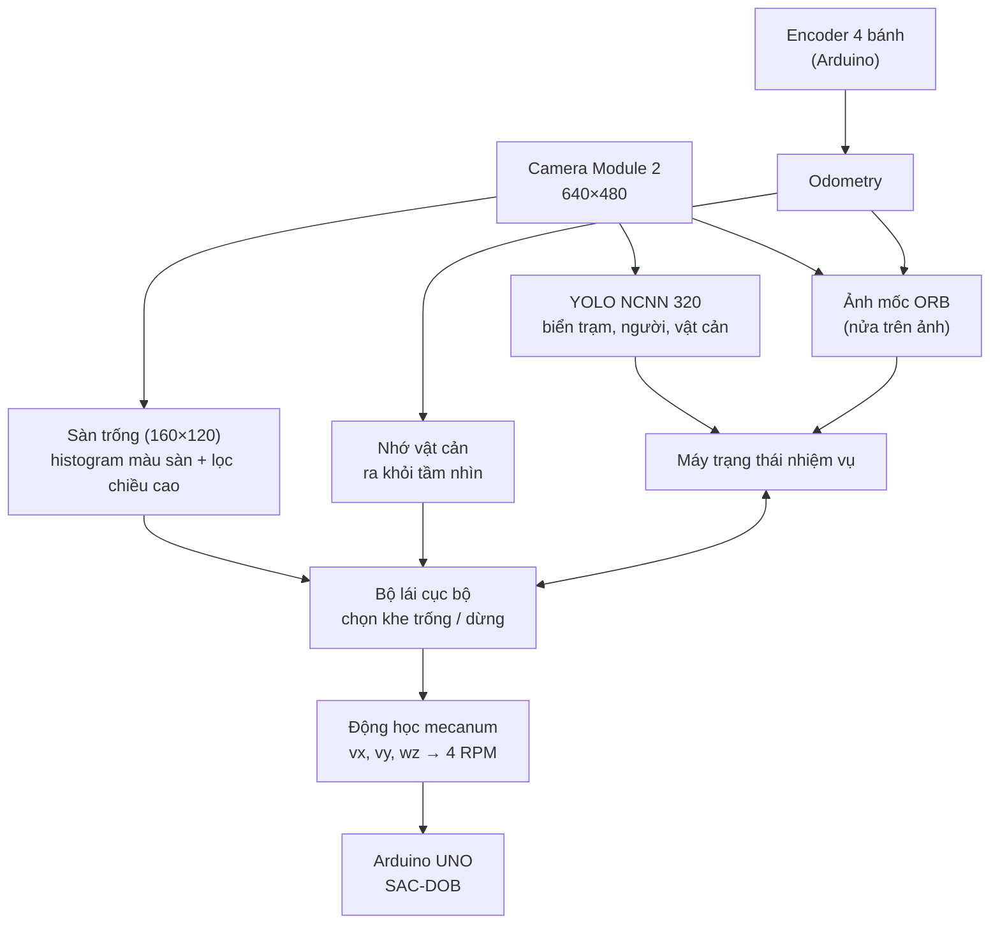
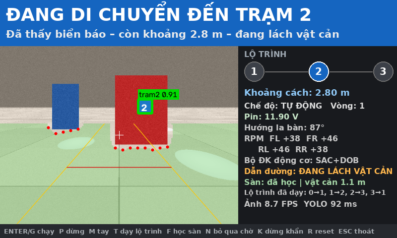
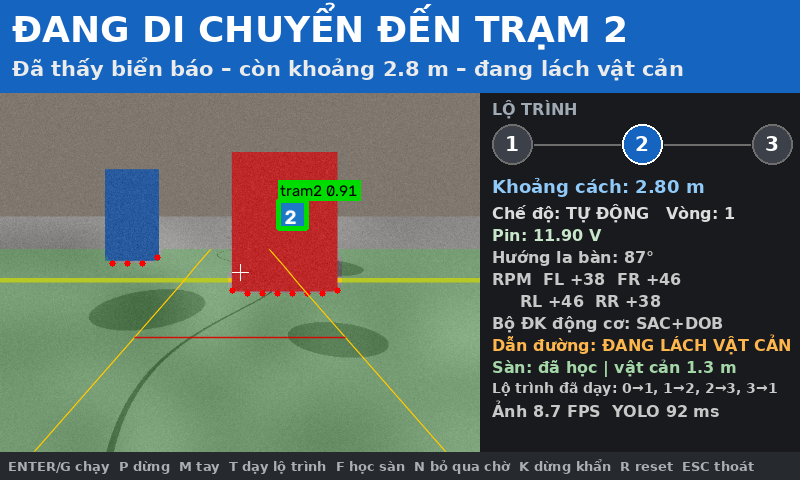

# DẪN ĐƯỜNG BẰNG CAMERA – KHÔNG DÁN LINE (SÀN GẠCH ĐÁ HOA & BÊ TÔNG)

Robot chỉ dùng **1 camera** (Raspberry Pi Camera Module 2) để vừa nhận diện trạm, vừa tìm đường, vừa tránh vật cản.
Có 3 lớp dẫn đường chạy đồng thời trên Raspberry Pi 4:

| Lớp | Module | Nhiệm vụ | Cần chuẩn bị |
|---|---|---|---|
| 1. Nhận diện biển trạm (YOLO) | `robot/detector.py` | Thấy biển TRẠM 1/2/3 → tiến thẳng tới, căn giữa, ước lượng khoảng cách, dừng đúng chỗ | Huấn luyện YOLO (`docs/TRAINING.md`) |
| 2. Nhận diện mặt sàn trống | `robot/floor.py` | "Cảm biến khoảng cách ảo" từ camera: biết phía trước còn trống bao xa theo từng hướng → lách / dừng, phát hiện cả **vật lạ YOLO chưa học** | Không cần huấn luyện – tự học màu sàn |
| 3. Dạy – lặp lộ trình | `robot/route_memory.py` | Đi theo đường đã lái mẫu khi **trạm kế tiếp bị khuất** (sau dãy máy may, rẽ góc) | Lái tay robot 1 lần qua các trạm |



## 1. Robot đi từ trạm này sang trạm khác như thế nào?

```
 Rời trạm A ──► có lộ trình A→B đã dạy? ── có ──► FOLLOW: bám ảnh mốc
                      │                                │  thấy biển B gần hơn 2.5 m
                      không                            ▼
                      └──► SEARCH: quay tìm biển B ──► APPROACH: tiến tới biển B (YOLO)
                                                       │  khoảng cách ≤ 0.45 m & đã căn giữa
                                                       ▼
                                                     WAIT 20 s ──► trạm kế tiếp
 Suốt quá trình: vật cản trong làn < 0.8 m ──► OBSTACLE (dừng, hiển thị "GẶP VẬT CẢN")
                 vật cản ở xa hơn         ──► lách theo khe trống (mecanum đi chéo)
```

* **Các trạm nhìn thấy nhau** (xưởng thoáng): không cần dạy, robot quay tìm biển rồi tiến tới.
* **Trạm bị khuất**: dạy lộ trình một lần, robot sẽ tự đi theo; đến gần thấy biển thì YOLO dẫn vào đúng vị trí.

## 2. Nhận diện mặt sàn trống (`robot/floor.py`)

Nguyên lý (Ulrich & Nourbakhsh, AAAI 2000 – "Appearance-Based Obstacle Detection with Monocular Color Vision"):

1. Ảnh thu nhỏ 160×120, **lọc trung vị 5×5** → ron gạch (2–5 mm) và vân đá/bê tông biến mất.
2. Vùng **tham chiếu** = sàn ngay trước robot (đáy ảnh). Học **histogram 3D (L, a, b)** của vùng này.
   Histogram học được **nhiều màu cùng lúc** → gạch bông / đá hoa nhiều màu vẫn đúng.
3. Mỗi điểm ảnh: màu có trong histogram sàn (có dung sai) **và** không có cạnh sắc bất thường → là sàn.
4. **Vệt phản sáng đèn** trên gạch bóng (rất sáng, gần như không màu, phẳng) → vẫn là sàn.
5. Quét mỗi cột từ dưới lên: điểm đầu tiên **không phải sàn** và **nhô cao ≥ 8 cm** (đủ số hàng ảnh tương ứng
   tại khoảng cách đó) = chân vật cản → đổi ra mét: `X = h_cam / tan(góc_chúc + atan((y − 0.5)/f))`.
   → vết dầu, vết bẩn, vạch sơn phẳng, bóng đổ **không** bị coi là vật cản.
6. Khi robot **đang tiến trên đường trống**, histogram tự cập nhật (8 %/khung) → tự thích nghi khi đi từ
   sàn gạch sang sàn bê tông, khi ánh sáng thay đổi.

| Loại sàn | Đặt `FLOOR_TYPE` | Xử lý riêng |
|---|---|---|
| Gạch men / đá hoa / granite bóng | `"tile"` | nhận vệt phản sáng là sàn, ngưỡng vân cao (gạch có vân) |
| Gạch bông nhiều màu | `"tile"` hoặc `"auto"` | histogram nhiều màu; vùng học lần đầu lớn (phủ vài viên) |
| Bê tông thô / bê tông mài / epoxy | `"concrete"` | dung sai độ sáng lớn (vết dầu, bóng), ngưỡng vân thấp |
| Lẫn lộn / chưa rõ | `"auto"` (mặc định) | trung hòa hai loại trên |

Kết quả kiểm thử trên ảnh tổng hợp chiếu phối cảnh đúng camera (`tests/test_floor_nav.py`, 2 góc chúc 0° và 10°):

| Sàn | Báo nhầm (sàn sạch có ron / hoa văn / phản sáng / vết dầu / vết nứt / vạch sơn) | Hộp nâu, xanh, đen, đỏ đặt cách 1.2 m |
|---|---|---|
| Gạch đá hoa trơn | 0 | phát hiện ở 1.08–1.22 m |
| Gạch bông | 0 | phát hiện ở 1.12–1.22 m |
| Bê tông (vết dầu, nứt, vạch sơn vàng) | 0 | phát hiện ở 1.08–1.22 m |

Giao diện: vùng sàn trống tô **xanh**, chân vật cản **chấm đỏ**, 2 đường **vàng** = làn đường bằng bề rộng thật của robot,
vạch **đỏ** ngang = khoảng dừng.




**Giới hạn (ghi vào báo cáo):** vật **cùng màu với sàn** (thùng xám trên bê tông xám, thùng trắng/kem trên gạch kem)
không tách được bằng màu → YOLO lớp `vat_can` là lớp bảo vệ thứ hai; nên chọn thùng/xe đẩy màu tương phản với sàn.
Sàn phản chiếu như gương làm ảnh phản chiếu của máy móc xuất hiện "dưới sàn" → dùng **kính lọc phân cực (CPL)** cho camera,
hoặc giảm `FLOOR_LIKE_RATIO`.

### Hiệu chỉnh nhận diện sàn

| Hiện tượng | Chỉnh trong `robot/config.py` |
|---|---|
| Hay báo vật cản giả trên sàn | đặt đúng `FLOOR_TYPE`; giảm `FLOOR_LIKE_RATIO` (0.12 → 0.08); tăng `FLOOR_MIN_OBST_HEIGHT_M` |
| Không thấy vật thấp (hộp nhỏ) | giảm `FLOOR_MIN_OBST_HEIGHT_M` (0.08 → 0.05); tăng `FLOOR_LIKE_RATIO` |
| Khoảng cách vật cản sai | đo lại `CAMERA_HEIGHT_M`, `CAMERA_TILT_DEG` (sai 2 cm chiều cao ≈ sai 8 % khoảng cách) |
| Thân robot lọt vào đáy ảnh | tăng `FLOOR_BOTTOM_CROP` (vd 0.08) |
| Lúc khởi động báo "Sàn: CHƯA HỌC" / học sai | đặt robot nhìn ra lối đi trống rồi nhấn **F** |

## 3. Bộ lái cục bộ – lách hoặc dừng (`robot/navigator.py`)

* Từ các điểm chân vật cản (sàn + YOLO) tính chiều dài đường trống `L(θ)` cho **làn rộng bằng thân robot**
  (`2 × (ROBOT_HALF_WIDTH_M + NAV_SAFETY_MARGIN_M)`) theo 19 hướng trong góc nhìn camera.
* Hướng tới đích còn trống → giữ nguyên lệnh. Bị chặn → chọn hướng **trống hoàn toàn gần đích nhất** (kiểu VFH).
* `NAV_AVOID_MODE = "strafe"`: bánh mecanum **đi chéo** tránh vật mà đầu robot vẫn hướng về biển trạm.
* Vật cản trong làn chuyển động **gần hơn `OBST_STOP_DISTANCE_M` (0.8 m) → luôn DỪNG** và hiển thị "GẶP VẬT CẢN";
  vật đi khỏi `OBST_CLEAR_S` giây → tự chạy tiếp.
* **Bộ nhớ vật cản** (odometry, 10 s): camera chỉ nhìn ±31°, khi lách qua vật sẽ lọt ra bên hông → vẫn nhớ để không quẹt.
* Muốn robot **chỉ dừng chờ, không tự lách** (đúng yêu cầu ban đầu khắt khe nhất): `NAV_AVOID_ENABLE = False`.

## 4. Dạy – lặp lộ trình (`robot/route_memory.py`)

### Cách dạy (làm 1 lần cho mỗi chặng)

1. Chạy `python main.py`, đặt robot ở **vị trí xuất phát**, nhìn thấy lối đi.
2. Nhấn **M** (chế độ tay) → nhấn **T**: màn hình "ĐANG DẠY LỘ TRÌNH: XUẤT PHÁT → TRẠM 1".
3. Lái bằng **W/S** (tiến/lùi), **A/D** (đi ngang), **Q/E** (quay) – đi chậm, đều, đúng đường mong muốn,
   đến trước biển TRẠM 1 (~0.5–0.7 m) → nhấn **T** để lưu. Robot tự chuyển đích sang TRẠM 2.
4. Nhấn **T** lần nữa, lái từ TRẠM 1 → TRẠM 2, nhấn **T**... tương tự TRẠM 2 → 3 và TRẠM 3 → 1 (nếu chạy vòng).
5. Các chặng lưu trong `routes/leg_<từ>_to_<đến>.npz`; bảng bên phải màn hình liệt kê "Lộ trình đã dạy".
   Dạy lại chặng nào thì ghi đè chặng đó. Nhấn **U** để hủy khi đang dạy.

### Cách lặp

Mỗi ~25 cm robot đã lưu một ảnh mốc (đặc trưng ORB của **nửa trên ảnh**: máy may, kệ, cột, tường, đèn –
phần sàn bị loại vì ron gạch lặp lại dễ khớp nhầm). Khi chạy tự động:
* lệch ngang trung vị của các điểm khớp → quay về đúng hướng như lúc dạy (funnel lane, Chen & Birchfield 2006);
* ảnh mốc kế tiếp khớp tốt hơn → chuyển mốc; odometry chỉ dùng để hỗ trợ (bánh mecanum trượt trên gạch bóng);
* thấy biển trạm trong 2.5 m → chuyển sang YOLO tiếp cận chính xác;
* mất khớp > 2.5 s (bị che, cảnh thay đổi lớn) → quay tìm biển trạm; quá 30 s → báo "KHÔNG TÌM THẤY TRẠM".

**Lưu ý:** cảnh vật thay đổi nhiều (dời máy may, kệ hàng) → dạy lại chặng đó. Ánh sáng thay đổi vừa phải được bù bằng CLAHE.

## 5. Khuyến nghị lắp đặt cho 2 loại sàn

| Hạng mục | Sàn gạch / đá hoa bóng | Sàn bê tông |
|---|---|---|
| Camera | cao 20–30 cm, chúc xuống 5–10°, **kính lọc phân cực** nếu sàn bóng gương | cao 20–30 cm, chúc 5–10° |
| `FLOOR_TYPE` | `"tile"` | `"concrete"` |
| `ACCEL_LIMIT_RPM_S` | 200 (giảm trượt bánh) | 300 |
| `V_APPROACH_MAX`, `ROUTE_V` | 0.18 m/s | 0.22 m/s |
| Bánh mecanum | lau sạch con lăn (bụi vải làm trơn) | kiểm tra con lăn mòn; khe nối / vết nứt sâu gây giật → giảm tốc |
| SAC-DOB | DOB bù ma sát thay đổi khi bánh trượt | DOB bù tải thay đổi khi qua khe nối, mặt nhám |
| Ánh sáng | tránh đèn chiếu thẳng xuống lối đi (vệt sáng lớn) | đủ sáng ≥ 200 lux để camera ít nhiễu |
