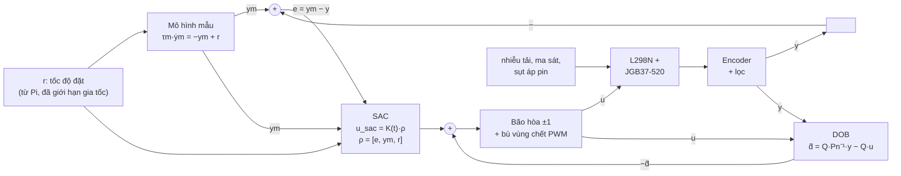
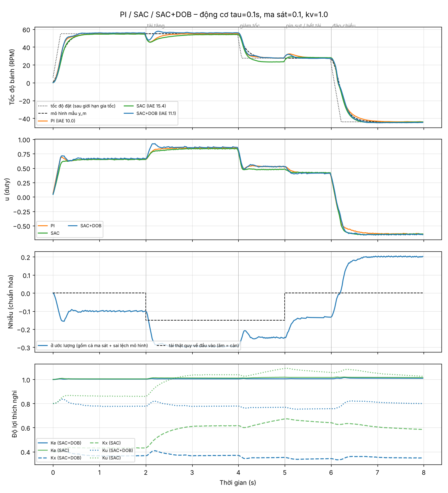

# THUẬT TOÁN ĐIỀU KHIỂN TỐC ĐỘ ĐỘNG CƠ: SAC + DOB (THÍCH NGHI)

Mỗi bánh xe có một bộ điều khiển độc lập chạy trên Arduino UNO, chu kỳ `Ts = 20 ms`.
Mã nguồn: `firmware/robot_firmware/sac_dob.h` (C++) – bản Python **giống hệt**: `robot/sac_dob.py`
(được kiểm tra tự động bằng `tests/test_sac_dob.py::test_cpp_firmware_matches_python`).

## 1. Sơ đồ khối



Tín hiệu được **chuẩn hóa**: `y = RPM / 110`, `u = duty ∈ [−1, 1]` → cùng bộ tham số dùng được cho mọi động cơ.

## 2. SAC – Simple Adaptive Control (Kaufman – Barkana – Sobel)

**Mô hình mẫu** (đáp ứng mong muốn, bậc 1):

```
τm · dym/dt = −ym + r          rời rạc:  ym[k+1] = am·ym[k] + (1 − am)·r[k],  am = e^(−Ts/τm)
```

**Luật điều khiển** – véc-tơ hồi quy gồm sai số đầu ra, trạng thái mô hình mẫu và đầu vào mô hình mẫu:

```
e   = ym − y
ρ   = [ e ,  ym ,  r ]ᵀ
u_sac = K(t)·ρ = Ke·e + Kx·ym + Ku·r
```

**Luật thích nghi** (độ lợi tỉ lệ + tích phân, có σ-modification):

```
K_P,i = Γp,i · e · ρi
dK_I,i/dt = Γi,i · e · ρi − σ · (K_I,i − K0,i)
K = K_P + K_I
```

* `Ke` (độ lợi sai số) tăng khi sai số kéo dài → "độ lợi cao thích nghi" (đặc trưng của SAC).
* `Kx`, `Ku` thích nghi thành bộ truyền thẳng lý tưởng để `y` bám `ym` khi tham số động cơ thay đổi.
* Động cơ DC bậc 1 (quán tính + cản nhớt, hệ số dương) là hệ **ASPR** (gần như thực dương chặt) – điều kiện ổn định của SAC.

**Các biện pháp chống trôi / chống bão hòa (robust):**

| Biện pháp | Mục đích |
|---|---|
| σ-modification kéo `K_I` về `K0` | chống trôi tham số do nhiễu đo |
| Vùng chết `|e| < SAC_E_DEADBAND` → ngừng thích nghi | encoder lượng tử hóa không làm độ lợi tăng mãi |
| Chặn `K_MIN ≤ K_I ≤ K_MAX` (phép chiếu) | độ lợi luôn nằm trong vùng an toàn |
| Ngừng thích nghi khi `u` bão hòa cùng chiều `e` | chống "windup" của luật thích nghi |
| `hold()` khi đứng yên: reset trạng thái nhưng **giữ độ lợi đã học** | khởi động lại không giật, không mất kết quả thích nghi |

## 3. DOB – Disturbance Observer (bộ quan sát nhiễu)

Mô hình danh định của động cơ (nhận dạng bằng `tools/motor_test.py ident`):

```
Pn(s) = Kn / (τn·s + 1)
```

Nhiễu quy đổi về đầu vào (gồm tải, ma sát, sai lệch mô hình, sụt áp pin):

```
d̂ = Q(s)·Pn⁻¹(s)·y − Q(s)·u ,       Q(s) = 1 / (τq·s + 1)
u = sat( u_sac − d̂ )
```

`Q·Pn⁻¹ = (τn·s + 1) / (Kn·(τq·s + 1))` là hợp thức (proper), cài đặt rời rạc Euler lùi:

```
yf  += aq·(y − yf)                         aq = Ts/(τq + Ts)        (yf = Q·y)
d̂   = [ τn·(y − yf)/τq + yf ] / Kn − uf                             (uf = Q·u bước trước)
uf  += aq·(u − uf)
```

Hiệu quả: khi DOB hoạt động, đối tượng "nhìn từ SAC" gần với mô hình danh định `Pn`, nên SAC
chỉ phải thích nghi phần sai lệch nhỏ → tốc độ hồi phục khi có tải nhanh hơn rõ rệt.

## 4. Cài đặt trên Arduino UNO

| Bước trong 1 chu kỳ 20 ms | Mô tả |
|---|---|
| 1. Đọc encoder | Đếm cạnh kênh A bằng ngắt (INT0/INT1/PCINT1), 1980 xung/vòng |
| 2. Tốc độ | `RPM = Δxung·60/(1980·dt)` → chuẩn hóa → lọc thông thấp α = 0.5 |
| 2b. Con quay | Đọc tốc độ quay trục Z của MPU-6050 (I2C A4/A5), trừ độ lệch 0, tích phân → góc yaw gửi về Pi |
| 3. An toàn | Dừng khẩn (lệnh `E,1`), mất lệnh từ Pi > 500 ms → đặt 0 |
| 4. Giới hạn gia tốc | `r` tiến dần đến tốc độ đặt (300 RPM/s) |
| 5. SAC + DOB | `u = update(r, y)` |
| 6. Xuất PWM | Bù vùng chết PWM (28/255) + chiều IN1/IN2 trên L298N |
| 7. Debug (tùy chọn) | `X,...` ref, ym, y, u, d̂, Ke, Kx, Ku – để vẽ đồ thị báo cáo |

Tải CPU ước tính dưới 25 % (4 bộ điều khiển số thực ~2–3 ms/chu kỳ + ~15 000 ngắt encoder/giây ở tốc độ tối đa).
Đã biên dịch với Arduino AVR core 1.8.6 (board UNO), không cảnh báo: 16 202 byte (49 % flash), RAM tĩnh 797 byte (39 %).
Đã chạy trên ATmega328P mô phỏng (simavr) + mô hình động cơ: bám 50 RPM ±1 sau khoảng 0,6 s (`tests/test_firmware_sim.py`).

## 5. Kết quả mô phỏng (`python tools/sac_dob_sim.py`)

Mô hình: động cơ bậc 1 + ma sát Coulomb + vùng chết + sụt áp L298N + encoder lượng tử hóa 1 kênh + trễ 1 mẫu.
Kịch bản: đặt 55 RPM → tải tăng đột ngột (2 s) → giảm còn 27.5 RPM (4 s) → pin sụt 12.4→10.8 V (5 s) → đảo chiều −44 RPM (6 s).



| Động cơ mô phỏng | Bộ ĐK | IAE tổng (RPM·s) | IAE khi có nhiễu tải |
|---|---|---|---|
| Danh định (τ = 0.10 s) | PI | 10.0 | 4.19 |
| | SAC | 15.4 | 5.10 |
| | **SAC + DOB** | 11.1 | **2.81** |
| Chậm, ma sát lớn (τ = 0.18 s, kv = 0.85) | PI | 33.8 | 10.7 |
| | SAC | 43.7 | 13.7 |
| | **SAC + DOB** | **31.3** | **9.8** |

**Nhận xét trung thực cho báo cáo:**
* SAC + DOB **khử nhiễu tải tốt nhất** (giảm ~33 % IAE khi có tải so với PI ở động cơ danh định) và **bền vững hơn
  khi tham số động cơ khác danh định** (động cơ chậm/nặng: tốt hơn PI ở mọi chỉ tiêu).
* Ở đúng điểm danh định, PI đã chỉnh tốt có IAE tổng thấp hơn một chút – lợi thế của SAC+DOB nằm ở tính thích nghi/bền vững.
* SAC đơn thuần (không DOB) khử nhiễu chậm vì không có khâu tích phân trực tiếp – đó là lý do kết hợp với DOB.
* Đây là mô phỏng; kết quả thật phải đo trên robot bằng `tools/motor_test.py step --modes 0 1 2`.

## 6. Quy trình chỉnh tham số trên robot thật

1. **Kê robot lên**, chạy `python tools/motor_test.py ident` → nhận `PWM_DEADZONE`, `DOB_KN`, `DOB_TAU_N` gợi ý.
2. Sửa `robot/config.py`, nạp lại: `python flash_arduino.py`.
3. Đo đáp ứng: `python tools/motor_test.py step --modes 0 1 2` → đồ thị + CSV trong `logs/`.
4. Chỉnh nhanh không cần nạp lại (mất khi reset):
   ```
   python tools/motor_test.py tune taum 0.12     # đáp ứng nhanh hơn
   python tools/motor_test.py tune tauq 0.15     # DOB êm hơn (bớt rung)
   python tools/motor_test.py tune gix 15        # thích nghi nhanh hơn
   ```
5. Đặt robot xuống sàn, chạy `step --on-floor` để đo với tải thật; ghi giá trị tốt vào `config.py`.

| Hiện tượng | Chỉnh |
|---|---|
| Đáp ứng chậm, bám mô hình mẫu kém | giảm `SAC_TAU_M` (≥ 0.08), tăng `SAC_GAMMA_I` |
| Động cơ rung / kêu, `u` nhấp nhô | tăng `DOB_TAU_Q`, giảm `SAC_GAMMA_P`, tăng `SPEED_LPF_ALPHA` lọc mạnh hơn (giảm α) |
| Vọt lố khi có tải | giảm `SAC_GAMMA_I[1:]`, tăng `DOB_TAU_Q` |
| Tốc độ thấp bị giật, không quay đều | tăng `PWM_DEADZONE` (theo kết quả `ident`) |
| Độ lợi trôi dần sau thời gian dài | tăng `SAC_SIGMA` hoặc `SAC_E_DEADBAND` |
