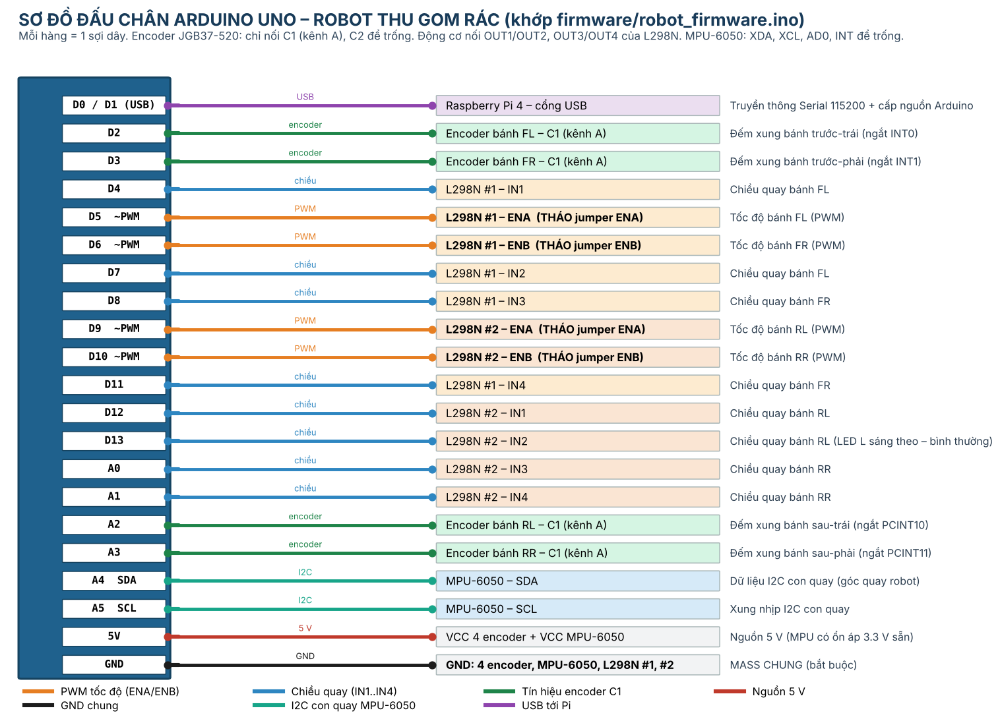
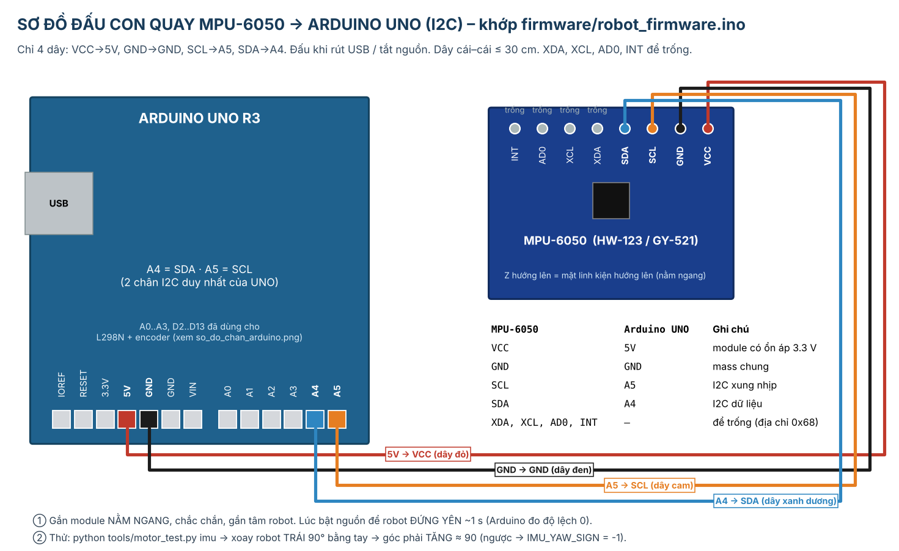

# SƠ ĐỒ ĐẤU DÂY – ROBOT THU GOM RÁC XƯỞNG MAY

> Mọi chân dưới đây khớp với `firmware/robot_firmware/robot_firmware.ino` và `robot/config.py`.
> Nếu đổi chân phải sửa cả hai file rồi chạy lại `python flash_arduino.py`.
> Sơ đồ hình: `img/so_do_chan_arduino.png`, `img/so_do_mpu6050.png`, `img/so_do_nguon.png` · Bảng tích từng dây: `BANG_DAU_DAY_ARDUINO.xlsx` ·
> Các bước nạp: `NAP_ARDUINO.md`.



## 1. Sơ đồ nguồn

```
 PIN LiPo 3S (11.1 V, đầy 12.6 V)
   │
   ├── CẦU CHÌ 10 A ── CÔNG TẮC NGUỒN CHÍNH
   │                        │
   │                        ├── NÚT DỪNG KHẨN (nấm đỏ, tiếp điểm NC) ──┬── L298N #1  [+12V]  (động cơ FL, FR)
   │                        │      (cắt NGUỒN ĐỘNG CƠ bằng phần cứng)  └── L298N #2  [+12V]  (động cơ RL, RR)
   │                        │
   │                        └── MẠCH HẠ ÁP 5 V ≥ 3 A (XL4015 5A / UBEC 5V-5A) ── Raspberry Pi 4 (USB-C hoặc chân 5V+GND)
   │                                                                              │
   │                                                                              └── USB ── Arduino UNO (nguồn + dữ liệu)
   │                                                                                          └── 5V ── MPU-6050, 4 encoder

 GND: nối CHUNG pin – L298N #1 – L298N #2 – Arduino – Raspberry Pi (rất quan trọng)
```

| Hạng mục | Khuyến nghị |
|---|---|
| Nguồn Pi 4 | Mạch hạ áp riêng 5.1 V ≥ 3 A (Pi 4 + camera + Arduino ~ 1.5–2.5 A). **Không** lấy 5 V từ L298N. Biểu tượng "tia sét" trên màn hình = thiếu áp. |
| Dây động cơ | ≥ 0.5 mm² (AWG 20). Dòng khởi động JGB37-520 ~1–1.5 A/động cơ. |
| Tụ lọc | 470–1000 µF / 25 V tại đầu vào mỗi L298N; 100 nF song song mỗi động cơ (chống nhiễu encoder). |
| Dừng khẩn | Nấm đỏ NC **cắt nguồn động cơ** bằng phần cứng. A4 đã dùng cho MPU-6050 nên không báo nút về Arduino (`ESTOP_INPUT_ENABLE = False`). |
| Pin LiPo | **Bắt buộc** gắn còi báo áp thấp từng cell (A5 đã dùng cho MPU-6050 nên Arduino không đo áp pin); không xả dưới 3.3 V/cell. |

## 2. Arduino UNO R3

| Chân UNO | Nối tới | Chức năng | Ghi chú |
|---|---|---|---|
| USB (D0/D1) | Raspberry Pi USB | Serial 115200 8N1 | Không dùng D0/D1 cho việc khác |
| **D2** | Encoder FL – kênh A (C1) | Ngắt INT0 | |
| **D3** | Encoder FR – kênh A (C1) | Ngắt INT1 | |
| **A2** | Encoder RL – kênh A (C1) | Ngắt PCINT10 | dùng như chân số |
| **A3** | Encoder RR – kênh A (C1) | Ngắt PCINT11 | dùng như chân số |
| **D5** (PWM) | L298N #1 **ENA** | PWM bánh FL | **tháo jumper ENA** |
| **D4** | L298N #1 IN1 | Chiều FL | |
| **D7** | L298N #1 IN2 | Chiều FL | |
| **D6** (PWM) | L298N #1 **ENB** | PWM bánh FR | **tháo jumper ENB** |
| **D8** | L298N #1 IN3 | Chiều FR | |
| **D11** | L298N #1 IN4 | Chiều FR | |
| **D9** (PWM) | L298N #2 **ENA** | PWM bánh RL | **tháo jumper ENA** |
| **D12** | L298N #2 IN1 | Chiều RL | |
| **D13** | L298N #2 IN2 | Chiều RL | LED onboard sáng theo – bình thường |
| **D10** (PWM) | L298N #2 **ENB** | PWM bánh RR | **tháo jumper ENB** |
| **A0** | L298N #2 IN3 | Chiều RR | |
| **A1** | L298N #2 IN4 | Chiều RR | |
| **A4** (SDA) | MPU-6050 – **SDA** | I2C dữ liệu con quay | `IMU_ENABLE = True` |
| **A5** (SCL) | MPU-6050 – **SCL** | I2C xung nhịp con quay | không đảo SDA/SCL |
| 5V | VCC 4 encoder + VCC MPU-6050 | Nguồn 5 V | module MPU có ổn áp 3.3 V sẵn |
| GND | GND encoder, GND 2 L298N, GND MPU-6050 | Mass chung | |

> Arduino UNO chỉ có 18 chân I/O khả dụng (trừ D0/D1). 4 động cơ × 3 chân + 4 encoder + 2 chân I2C (MPU-6050) = **18 chân – dùng hết**.
> Vì vậy mỗi encoder chỉ nối **kênh A**; chiều quay được suy ra từ lệnh (firmware chỉ đổi chiều đếm khi bánh gần dừng nên không bị đếm sai lúc đảo chiều). Kênh B (C2) để trống.

**Khuyến nghị:** điện trở 10 kΩ kéo xuống GND tại mỗi chân ENA/ENB để động cơ chắc chắn tắt trong lúc Arduino khởi động / nạp chương trình.

### 2a. Con quay MPU-6050 ("la bàn" của robot) – nối ARDUINO



| Chân module MPU-6050 (HW-123 / GY-521) | Nối tới Arduino UNO | Ghi chú |
|---|---|---|
| VCC | **5V** | module có ổn áp 3.3 V sẵn |
| GND | **GND** | mass chung |
| SCL | **A5** | I2C xung nhịp |
| SDA | **A4** | I2C dữ liệu |
| XDA, XCL | để trống | I2C phụ – không dùng |
| AD0 | để trống | địa chỉ 0x68 (nối VCC → 0x69, khi đó sửa `IMU_I2C_ADDR`) |
| INT | để trống | không dùng |

* MPU-6050 = con quay 3 trục + gia tốc kế, **không có từ kế** → đo **góc quay tương đối** (0° = hướng lúc bật / mở main.py),
  không bị khung sắt nhà xưởng làm lệch. Firmware tích phân tốc độ quay trục Z ở 50 Hz, tự bù độ trôi khi robot đứng yên.
* Gắn module **nằm ngang** (chữ in hướng lên), cố định chắc, gần tâm robot; dây I2C ≤ 30 cm, xoắn cặp SDA/SCL với GND nếu được.
* Bật nguồn / mở `main.py`: để robot **đứng yên ~1 s** (Arduino đo độ lệch 0 của con quay).
* Nếu bo có đầu cắm trắng 4 chân thì vẫn nên hàn/cắm vào **hàng chân có in chữ** để chắc chắn đúng thứ tự VCC-GND-SCL-SDA.
* Kiểm tra: `python tools/motor_test.py imu` → xoay robot trái 90° bằng tay → góc phải **tăng** ≈ 90.

## 3. L298N (×2)

| Cực L298N | #1 (trước) | #2 (sau) |
|---|---|---|
| +12V | Sau nút dừng khẩn | Sau nút dừng khẩn |
| GND | GND chung | GND chung |
| +5V | để trống (giữ jumper 5V-EN để mạch tự cấp logic) | để trống (giữ jumper 5V-EN) |
| OUT1 / OUT2 | Động cơ FL (M1/M2) | Động cơ RL |
| OUT3 / OUT4 | Động cơ FR | Động cơ RR |
| ENA / ENB | D5 / D6 (tháo jumper) | D9 / D10 (tháo jumper) |
| IN1..IN4 | D4, D7, D8, D11 | D12, D13, A0, A1 |

L298N sụt áp ~2 V → với pin 12 V động cơ chỉ nhận ~10 V, tốc độ tối đa thực tế ~85–95 RPM. Đó là lý do `WHEEL_RPM_LIMIT = 85`.

## 4. Động cơ JGB37-520 có encoder (6 dây)

Board encoder thường ghi: `M1  GND  C1  C2  3.3V/VCC  M2` (màu dây hay gặp: đỏ M+, trắng M−, xanh dương VCC, đen GND, vàng C1, xanh lá C2 – **kiểm tra nhãn thực tế**).

| Dây động cơ | Nối tới |
|---|---|
| M1, M2 | OUTx của L298N |
| VCC | 5 V Arduino |
| GND | GND Arduino |
| C1 (kênh A) | D2 / D3 / A2 / A3 (theo bánh) |
| C2 (kênh B) | không nối |

Thông số: 11 xung/vòng trục động cơ × tỉ số ~1:90 → 990 xung/vòng bánh trên 1 kênh, đếm 2 cạnh → **1980 xung/vòng**.
Kiểm tra tỉ số thật: `python tools/motor_test.py count --wheel 0 --turns 10`.

## 5. Bánh mecanum 97 mm – lắp đúng chiều con lăn

Nhìn **từ trên xuống**, trục con lăn của 4 bánh phải tạo thành hình **chữ X**:

```
        TRƯỚC
    FL  \\   //  FR
          ROBOT
    RL  //   \\  RR
        SAU
```
Kiểm tra: `python tools/motor_test.py pattern` – lệnh "SANG TRÁI" phải đi ngang thẳng, không xoay.

## 6. Raspberry Pi 4

| Chân Pi (vật lý) | GPIO | Nối tới | Ghi chú |
|---|---|---|---|
| Cổng CSI | – | Camera Module 2 (cáp dẹt 15 chân) | mặt tiếp xúc quay về phía cổng HDMI |
| USB | – | Arduino UNO | `/dev/ttyACM0` (chính hãng) hoặc `/dev/ttyUSB0` (CH340) |
| HDMI / DSI | – | Màn hình 5"–7" (800×480) | |
| 3 | GPIO2 SDA | SDA LCD 16x2 I2C (nếu có) | bật I2C trong raspi-config |
| 5 | GPIO3 SCL | SCL LCD 16x2 (nếu có) | |
| 6 / 9 | GND | GND LCD / nút nhấn | |
| 11 | GPIO17 | Nút START (NO → GND) | tùy chọn `GPIO_ENABLE` |
| 13 | GPIO27 | Nút STOP (NO → GND) | tùy chọn |
| 12 | GPIO18 | Còi 5 V qua transistor NPN | tùy chọn |
| 2 / 4 | 5V | LCD 16x2 I2C (VCC) | LCD PCF8574 thường cần 5 V |

> Con quay MPU-6050 nối **Arduino** (mục 2a), KHÔNG nối Pi. Chỉ khi thay bằng la bàn từ GY-271 (QMC5883L/HMC5883L)
> mới nối vào I2C của Pi (3.3V chân 1, SDA chân 3, SCL chân 5, GND chân 6) và đặt `COMPASS_ENABLE = True`, `IMU_ENABLE = False`.
> Kiểm tra LCD: `i2cdetect -y 1` phải thấy `27` (hoặc `3f`).

## 7. Camera

* Gắn ở giữa phía trước robot, cao 20–30 cm, **chúc xuống 5–10°** để thấy rõ sàn phía trước (dẫn đường, vật cản);
  đo chiều cao tâm ống kính → `CAMERA_HEIGHT_M`, góc chúc → `CAMERA_TILT_DEG` (sai 2 cm ≈ sai 8 % khoảng cách).
* Sàn gạch bóng như gương: gắn **kính lọc phân cực (CPL)** trước ống kính để giảm phản chiếu.
* Nếu thân robot lọt vào đáy ảnh: đặt `FLOOR_BOTTOM_CROP` (vd 0.08).
* Biển báo trạm treo **ngang tầm camera** để ước lượng khoảng cách chính xác.
* Lắp ngược thì đặt `CAMERA_FLIP = "hv"`.
* Kiểm tra camera: `rpicam-hello -t 5000` (hoặc `libcamera-hello` trên bản cũ).
